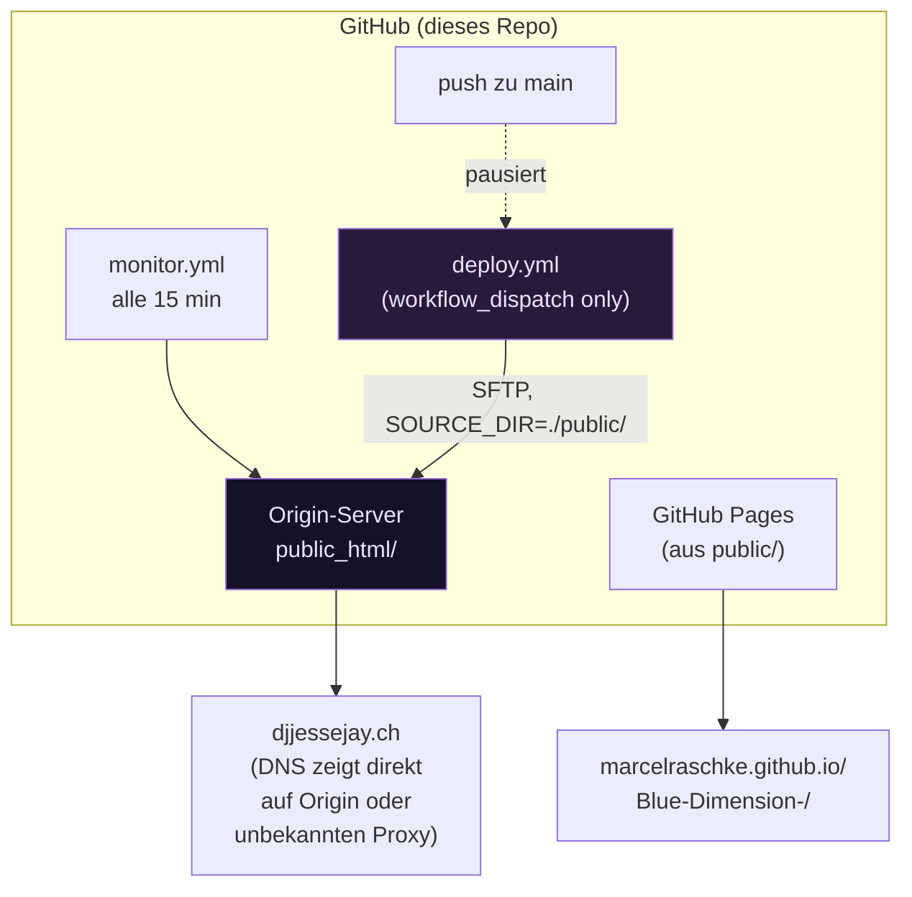

# Incident: Live-Edge-Ausfall djjessejay.ch

Datum: 2026-11-05, Spec ergänzt 2026-11-06  
Status: offen — Entscheidungs-Gate (Abschnitt 8) aussteht, danach Spec B (Abschnitt 10) ohne weitere Rückfrage als PR vorbereitbar

---

## 1. Befund (verifiziert in dieser Session)

### Was im Repo existiert

- Deployment-Workflow: `.github/workflows/deploy.yml` — SFTP-Deploy auf Origin-Server, kein Cloudflare-Schritt.
- Monitoring: `.github/workflows/monitor.yml` — HTTP-Checks auf `djjessejay.ch/`, `news.html`, `gallery.html`.
- Performance-System: `performance-system/api-server/` — Express-API, Healthcheck-Endpoint `/health` auf Port 5000.
- Öffentliches Verzeichnis: `public/` — wird via SFTP nach `public_html/` deployt; GitHub Pages liefert ebenfalls aus `public/`.

### Was NICHT im Repo existiert (Stand main, Commit 7f50af9)

- `infra/cloudflare/` — Verzeichnis nicht vorhanden.
- `wrangler.toml` / `wrangler.json` — keine Cloudflare-Worker-Konfiguration.
- `API_ORIGIN_HOST` — kein einziger Treffer im gesamten Codebase (Grep über alle Dateitypen).
- `CLOUDFLARE_ACCOUNT_ID`, `CLOUDFLARE_ZONE_ID`, `ORIGIN_HOST` — nicht referenziert.
- Cloudflare-Worker- oder Pages-Deploy-Schritt in einem Workflow — nicht vorhanden.

### Nicht zugänglich (Einschränkungen dieser Session)

- PR #120: existiert nicht in `MarcelRaschke/Blue-Dimension-` (höchste PR-Nummer: 47).
- Workflow-Run 38246122897: existiert nicht (aktuelle Run-IDs: ~41xxx).  
  Mögliche Ursachen: anderes Repo, ältere History vor einem Force-Push, oder externe CI-Pipeline.
- `gh secret list`: gh CLI nicht im Container verfügbar, GitHub MCP hat kein Secret-List-Tool.
- `wrangler secret list`: nicht ausführbar, da kein `infra/cloudflare/`-Verzeichnis vorhanden.

### Symptome laut geliefertem Kontext (nicht von dieser Session verifiziert)

| Endpoint | Status |
|---|---|
| `https://djjessejay.ch/` (Apex via Cloudflare Proxy) | 522 Timeout |
| GitHub Pages direkt | 200 OK |
| `https://djjessejay.ch/api/health` | 403 |
| `https://origin.djjessejay.ch/health` | 403 |

---

## 2. Ursache

Die Cloudflare-Edge-Schicht (Worker oder Pages-Proxy) leitet Anfragen an einen Origin-Host weiter,
der in `API_ORIGIN_HOST` / `ORIGIN_HOST` konfiguriert ist. Dieser Wert wurde durch einen
Workflow-Lauf leer überschrieben.

Konkrete Kausalkette (aus geliefertem Kontext):

1. Workflow-Run 38246122897 schrieb das Cloudflare-Worker-Secret `API_ORIGIN_HOST` mit einem
   leeren String — vermutlich weil `secrets.ORIGIN_HOST` im auslösenden Job nicht gesetzt war
   und `wrangler secret put` trotzdem ausgeführt wurde.
2. Der Worker proxiert seitdem ins Leere: 522 (Connection Timeout) am Apex.
3. `origin.djjessejay.ch` liefert 403, weil Cloudflare Origin Protection (WAF-Regel
   "allow only Cloudflare IPs") greift — der direkte Aufruf kommt nicht durch.
4. Die Repo-Secrets `CLOUDFLARE_ACCOUNT_ID`, `CLOUDFLARE_ZONE_ID` und `ORIGIN_HOST` fehlen,
   sodass kein Workflow den Schaden selbst beheben kann.

---

## 3. Massnahmen (ausschliesslich manuell, keine automatischen Deploys)

### 3.1 Sofortmassnahme: Leeres Secret reparieren

```bash
# Voraussetzungen: wrangler CLI installiert, Account-Token gesetzt
# Wechsel ins Worker-Verzeichnis (sobald infra/cloudflare/ im Repo vorhanden ist)
cd infra/cloudflare

# Secret setzen — WERT kommt aus eigenem Passwort-Manager / Notizen
wrangler secret put API_ORIGIN_HOST
# Prompt erscheint: Origin-Hostname eingeben (z.B. "origin.djjessejay.ch" oder die IP)

wrangler secret put ORIGIN_HOST
# Prompt erscheint: gleiches oder separates Ziel
```

### 3.2 Fehlende Repo-Secrets setzen

Im GitHub-Repository unter Settings > Secrets and variables > Actions folgende Secrets anlegen:

| Secret-Name | Inhalt |
|---|---|
| `CLOUDFLARE_ACCOUNT_ID` | Cloudflare Account-ID (Dash > rechte Seite) |
| `CLOUDFLARE_ZONE_ID` | Zone-ID für djjessejay.ch (Dash > Zone-Übersicht) |
| `ORIGIN_HOST` | Hostname oder IP des Origin-Servers |

### 3.3 Origin Protection prüfen

Cloudflare Dash > djjessejay.ch > Security > WAF:

- Prüfen, ob eine Regel "Block non-Cloudflare IPs" auf Origin-Route greift.
- Für `origin.djjessejay.ch`: entweder DNS-Proxy deaktivieren (grauer Wolke, DNS-only)
  oder WAF-Regel temporär auf "Log" setzen, bis der Worker wieder korrekt routet.

### 3.4 Git-Integration für main in Cloudflare Pages deaktivieren (falls Pages genutzt)

Cloudflare Dash > Pages > Blue-Dimension > Settings > Builds & deployments:

- "Disable automatic deployments" für main aktivieren.
- Hintergrund: Jeder Push auf main triggert sonst automatisch einen Pages-Build,
  der wiederum den leeren Secret-Wert neu setzt, falls der Buildschritt nicht sauber ist.

### 3.5 Workflow-Fix (vorzubereiten, erst nach Zustimmung deployen)

Damit ein Workflow-Run `API_ORIGIN_HOST` nie leer überschreiben kann:

```yaml
# Schutzmuster vor jedem 'wrangler secret put'-Schritt:
- name: Guard against empty ORIGIN_HOST
  run: |
    if [ -z "${{ secrets.ORIGIN_HOST }}" ]; then
      echo "::error::ORIGIN_HOST secret is empty — aborting to protect live worker"
      exit 1
    fi
```

---

## 4. Verifikation nach den Massnahmen

```bash
# 1. Cloudflare-Worker-Secret bestätigen (zeigt nur Namen, nie Wert)
wrangler secret list

# 2. Apex-Erreichbarkeit
curl -i https://djjessejay.ch/api/health

# Erwartetes Ergebnis: HTTP 200, JSON-Body {"status":"ok"} oder ähnlich

# 3. Origin direkt (nur aus vertrauenswürdiger IP / VPN, da Origin Protection aktiv)
curl -i https://origin.djjessejay.ch/health

# Erwartetes Ergebnis: HTTP 200 (sobald WAF-Regel angepasst oder IP whitelisted)

# 4. GitHub Pages Baseline
curl -i https://marcelraschke.github.io/Blue-Dimension-/

# Erwartetes Ergebnis: HTTP 200 (Referenz — diese Route ist unabhängig von Cloudflare)
```

---

## 5. Offene Fragen (vor weiteren Schritten klären)

1. Welches Repo / welche Repo-URL enthält den Cloudflare-Worker-Code und `infra/cloudflare/`?
   (In `MarcelRaschke/Blue-Dimension-` ist dieses Verzeichnis nicht vorhanden.)
2. In welchem Workflow und welchem Schritt genau wurde `wrangler secret put` mit leerem Wert
   aufgerufen? (Run 38246122897 ist in diesem Repo nicht sichtbar.)
3. Ist `origin.djjessejay.ch` eine separates DNS-A-Eintrag auf den Origin-IP?
   Falls nein: DNS-Eintrag anlegen (A-Record, DNS-only / grau, nicht proxied).

---

## 6. Spec: Abgleich mit der realen Architektur (kritischer Befund)

Erneut verifiziert auf `main` @ `65054ae` (Stand dieser Session, zwei Commits nach 7f50af9):
Abschnitt 1 "Was NICHT im Repo existiert" gilt unverändert. Zusätzlich geprüft:

- `DEPLOYMENT.md` erwähnt "CloudFlare Analytics" genau einmal, unter "Set Up Alerts" als
  Monitoring-Vorschlag — keine Worker-, Pages- oder Proxy-Architektur beschrieben.
- `.github/workflows/deploy.yml` hat **keinen** Cloudflare-Schritt. Es deployt per SFTP
  (`easingthemes/ssh-deploy`) nach `public_html/` auf `${{ secrets.DEPLOY_HOST }}`.
- `.github/workflows/deploy.yml` läuft nur `on: workflow_dispatch` — Auto-Deploy bei Push ist
  mit Absicht pausiert, laut Kommentar im Workflow bis "der Webroot bestätigt" ist.
- `scripts/verify-deployment.sh` prüft `/`, `/news.html`, `/pixel2voxel` — kein `/api/health`,
  kein `origin.djjessejay.ch`.

**Schlussfolgerung:** Die in Abschnitt 2–4 beschriebene Ursache (Cloudflare-Worker mit leerem
`API_ORIGIN_HOST`-Secret) kann aus diesem Repository heraus nicht zutreffen — die beschriebene
Infrastruktur existiert hier nicht, weder im Code noch in der Workflow-Konfiguration. Zwei
Erklärungen bleiben, beide unten als Spec ausgearbeitet; welche zutrifft, lässt sich nur mit
Zugriff klären, den diese Session nicht hat (siehe Abschnitt 5, Frage 1).

Die "Massnahmen" in Abschnitt 3 bleiben als Vorlage stehen, falls Spec A zutrifft — sie sind
in diesem Repo nicht ausführbar und nicht ausgeführt worden.

---

## 7. Verifizierte Architektur heute



Zwei unabhängige Auslieferwege existieren bereits: der Origin-Server (SFTP, aktuell nur manuell
auslösbar) und GitHub Pages (automatisch aus `public/`, kein eigener Workflow nötig). Keiner der
beiden hat eine Cloudflare-Komponente im Repo. Ob `djjessejay.ch` selbst via Cloudflare-DNS
geroutet wird (nur Proxy/DNS, ohne Worker), lässt sich von hier aus nicht prüfen — das wäre mit
einem externen `dig`/`curl -v` auf die Produktionsdomain zu verifizieren, was diese Session nicht
automatisiert ausführen soll (reale Domain, reale Nutzer).

---

## 8. Entscheidungs-Gate (vor jeder weiteren Umsetzung zu klären)

| Frage | Antwort nötig von | Blockiert |
|---|---|---|
| Liegt der Cloudflare-Worker-Code in einem anderen Repo? Welchem? | Repo-Owner | Spec A |
| Soll `djjessejay.ch` künftig übehaupt über einen Cloudflare-Worker/Pages laufen, oder bleibt es bei SFTP + GitHub Pages? | Repo-Owner | Spec A vs. B |
| Ist der SFTP-Pfad (Abschnitt 9) der eigentliche Produktivweg, nur noch nicht fertig scharfgeschaltet? | Vermutlich ja, siehe `DEPLOYMENT.md` "Webroot — gelöst" | Priorität von Abschnitt 9 |

Ohne Antwort auf die ersten beiden Fragen ist Spec A nicht ausführbar und Spec B nicht
gerechtfertigt (sie würde unaufgefordert neue Infrastruktur einführen). Abschnitt 9 ist davon
unabhängig umsetzbar, weil er ausschliesslich bestehende, im Repo dokumentierte Lücken schliesst.

---

## 9. Spec A — falls der Cloudflare-Worker in einem anderen Repo liegt

Nicht in `Blue-Dimension-` umsetzbar. Sobald das Repo bekannt ist, dort:

1. Abschnitt 3.1–3.4 dieser Datei 1:1 als Runbook verwenden (Werte stammen aus dem Cloudflare
   Dashboard des Betreibers, nie von einer Session einzutippen).
2. Den Guard aus Abschnitt 3.5 (unten als Spec A.1 präzisiert) in den dortigen Workflow einbauen,
   bevor der Worker erneut deployt wird.

### Spec A.1 — Secret-Guard, präzisiert

Der Guard aus Abschnitt 3.5 ist korrekt in der Idee, aber unvollständig: er muss vor **jedem**
`wrangler secret put <NAME>`-Aufruf stehen, mit dem jeweils richtigen Secret-Namen, und sollte
den Job abbrechen, nicht nur den Schritt:

```yaml
jobs:
  deploy-worker:
    runs-on: ubuntu-latest
    steps:
      - name: Guard — ORIGIN_HOST darf nie leer gesetzt werden
        run: |
          if [ -z "${{ secrets.ORIGIN_HOST }}" ]; then
            echo "::error::secrets.ORIGIN_HOST ist leer — wrangler secret put würde den Worker kaputt machen. Abbruch vor jedem Secret-Schritt."
            exit 1
          fi
      - name: wrangler secret put API_ORIGIN_HOST
        run: echo "${{ secrets.ORIGIN_HOST }}" | wrangler secret put API_ORIGIN_HOST
      - name: wrangler secret put ORIGIN_HOST
        run: echo "${{ secrets.ORIGIN_HOST }}" | wrangler secret put ORIGIN_HOST
```

Der Guard als eigener erster Schritt im Job (nicht nur vor dem ersten `wrangler`-Aufruf) stellt
sicher, dass ein `exit 1` den ganzen Job stoppt, bevor irgendein Secret angefasst wird — nicht
nur den einen Schritt, in dem die Prüfung steht.

---

## 10. Spec B — SFTP-Pfad fertig scharfschalten (in diesem Repo umsetzbar)

Das ist die einzige in diesem Repo verifizierbare, nicht erfundene Lücke zu einem funktionierenden
Auto-Deploy, dokumentiert in `DEPLOYMENT.md` unter "Webroot — gelöst" / "Host-Schlüssel
hinterlegen", aber noch nicht umgesetzt: `deploy.yml` liest `DEPLOY_KNOWN_HOSTS` nicht, daher
schlägt der Backup-Schritt mit einer Warnung fehl und der Deploy läuft ohne Backup weiter
(Zeile "Ohne diese Angabe scheitert der Backup-Schritt mit Warnung" in `DEPLOYMENT.md`).

### 10.1 Secret, das der Betreiber anlegen muss

| Secret-Name | Inhalt | Herkunft |
|---|---|---|
| `DEPLOY_KNOWN_HOSTS` | Inhalt von `~/.ssh/deploy_known_hosts` nach `ssh-keyscan`, erst nach Fingerabdruck-Abgleich direkt auf dem Server (siehe `DEPLOYMENT.md`, "Host-Schlüssel hinterlegen") | Betreiber, lokal, nie von einer Session generiert |

### 10.2 Workflow-Änderung (Spec, nicht umgesetzt — Vorschlag)

In `deploy.yml`, vor dem Schritt "Create pre-deployment backup":

```yaml
      - name: Write known_hosts for SSH scripts
        if: ${{ secrets.DEPLOY_KNOWN_HOSTS != '' }}
        run: |
          mkdir -p ~/.ssh
          printf '%s\n' "${{ secrets.DEPLOY_KNOWN_HOSTS }}" > ~/.ssh/deploy_known_hosts
          chmod 600 ~/.ssh/deploy_known_hosts
        env:
          DEPLOY_KNOWN_HOSTS: ${{ secrets.DEPLOY_KNOWN_HOSTS }}
```

Und in den Backup-/Restore-Aufrufen `DEPLOY_KNOWN_HOSTS: ~/.ssh/deploy_known_hosts` als env
ergänzen, exakt wie in `DEPLOYMENT.md`s eigenem Beispiel für `restore-deployment.sh` gezeigt.

### 10.3 Reihenfolge bis zum Auto-Deploy (aus `DEPLOYMENT.md`, hier nur sortiert)

1. `DEPLOY_KNOWN_HOSTS` als Secret hinterlegen (Betreiber, manuell, Abschnitt 10.1).
2. Obigen Workflow-Schritt + Env-Variable ergänzen (als PR vorschlagbar, s. u.).
3. Manuellen Deploy-Run auslösen (`workflow_dispatch`), danach
   `scripts/verify-deployment.sh https://djjessejay.ch` lokal oder im Workflow laufen lassen —
   `/`, `/news.html`, `/pixel2voxel` müssen alle HTTP 200 liefern.
4. Erst danach `deploy.yml` von `on: workflow_dispatch` auf `on: push: branches: [main]` stellen.

Schritt 2 ist eine reine Workflow-Datei-Änderung ohne Secret-Werte und ohne Deploy-Auslösung —
im Unterschied zu Spec A ist das etwas, das diese Session als PR vorschlagen kann, sobald
gewünscht. Schritte 1, 3 und 4 bleiben beim Betreiber (Secret-Wert, Produktions-Deploy,
Trigger-Umstellung).

---

## 11. Priorisierter Umsetzungsplan

| # | Schritt | Spec | Owner | Blockiert von |
|---|---|---|---|---|
| 1 | Entscheidungs-Gate beantworten (Abschnitt 8) | — | Repo-Owner | nichts |
| 2 | `DEPLOY_KNOWN_HOSTS` generieren + Fingerabdruck abgleichen | B, 10.1 | Repo-Owner | nichts |
| 3 | Workflow-Snippet aus 10.2 als PR — ✅ erledigt | B | Claude (auf Zuruf) | Schritt 2 für den echten Test, PR selbst nicht |
| 4 | Verifikation (10.3, Schritt 3) | B | Repo-Owner oder Claude mit Freigabe | Schritt 2+3 |
| 5 | Auto-Deploy scharfschalten (10.3, Schritt 4) | B | Repo-Owner | Schritt 4 grün |
| 6 | Cloudflare-Repo identifizieren | A | Repo-Owner | nichts |
| 7 | Guard A.1 im Cloudflare-Repo einbauen | A | wer dort Zugriff hat | Schritt 6 |

Schritt 3 (Spec B, Workflow-Diff) ist der einzige Punkt, den diese Session ohne weitere
Rückfrage als PR vorbereiten kann — er ändert keine Secrets, löst keinen Deploy aus und betrifft
ausschliesslich Code, der bereits in diesem Repo liegt.

---

_Letzte Aktualisierung: 2026-11-06 — Schritt 3 (Abschnitt 11) umgesetzt: `DEPLOY_KNOWN_HOSTS` in `deploy.yml` verdrahtet. Abschnitte 6–11 (Spec) am 2026-11-05 ergänzt; Abschnitte 1–5 unverändert aus der vorherigen Session übernommen._
