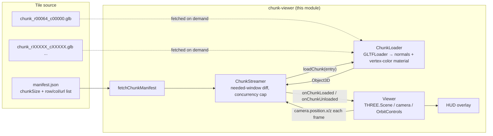

# Chunk Viewer

WebGL viewer and streaming pipeline for tiled mesh chunks. Loads and renders
a grid of glTF tiles named `chunk_r<row>_c<col>.glb`, streaming only the
tiles near the camera in and out as it moves. Built as the foundation for
visualizing large scanned/voxelized scenes (venue scans, terrain, point
cloud → mesh exports) inside the Blue Dimension performance system.

## Why this exists

A single sample tile, `chunk_r00064_c00000.glb`, arrived with no accompanying
pipeline: a glTF 2.0 binary generated by [trimesh](https://github.com/mikedh/trimesh),
45,484 vertices / 22,742 triangles, `POSITION` + `COLOR_0` only (no normals,
no material, no UVs — typical of a voxel or point-cloud-to-mesh export). The
filename encodes its position in a larger tile grid. This module is the
first piece of a pipeline to actually load and view that grid, built to
scale past one tile.

**Open question, inferred rather than confirmed:** the chunk size (256×256 on
the X/Z plane) was read off this one sample's bounding box
(`min [0,0,0]`, `max [256,279,256]`), and row→Z / column→X was assumed as the
mapping. Both live in `manifest.chunkSize`, not hard-coded, specifically so
they can be corrected once more tiles — or the pipeline that produced them —
are available.

## Architecture



`ChunkStreamer` is intentionally framework-agnostic — it only takes a
manifest, a `loadChunk` function, and load/unload callbacks, with no THREE.js
import at runtime. That's what makes it unit-testable (`ChunkStreamer.test.ts`)
without a WebGL context: tests inject a fake loader and assert on which keys
get requested, loaded, evicted, or retried.

## Chunk grid math

- `chunkWorldOrigin(row, col, chunkSize)` → world position of a tile's corner:
  `x = col * chunkSize.x`, `z = row * chunkSize.z`.
- `worldToChunkCoord(x, z, chunkSize)` → inverse, floored to the containing cell.
- `chunkDistance(a, b)` → Chebyshev distance, i.e. ring index on a square grid;
  used to decide which tiles fall inside `loadRadiusChunks`.

See `src/chunks/grid.ts`.

## Streaming behavior

On every frame, `Viewer` calls `ChunkStreamer.update(cameraX, cameraZ)`, which:

1. Computes the camera's current grid cell and the square window of cells
   within `loadRadiusChunks` of it.
2. Evicts (`onChunkUnloaded`) any loaded chunk outside that window — disposing
   its geometry/material and removing it from the scene.
3. Starts loading any chunk inside the window that isn't loaded or already
   in flight, up to `maxConcurrentLoads` concurrent requests.
4. If a chunk finishes loading after the camera has already moved past it,
   it's disposed immediately instead of being added to the scene.

## Manifest format

`public/chunks/manifest.json`:

```json
{
  "chunkSize": { "x": 256, "z": 256 },
  "chunks": [
    { "row": 64, "col": 0, "url": "/chunks/chunk_r00064_c00000.glb" }
  ]
}
```

To add more tiles: drop the `.glb` files into `public/chunks/` and add one
entry per tile to `chunks`. The manifest is fetched at startup (`no-cache` in
`nginx.conf`, unlike the tiles themselves) so a redeploy can add tiles without
rebuilding the app.

## Development

### Setup

```bash
npm install
```

### Development server

```bash
npm run dev
# Open http://localhost:3001
```

### Build

```bash
npm run build
# Output: ./build/
```

### Test / Lint / Type-check

```bash
npm test         # vitest — grid math + ChunkStreamer, no WebGL needed
npm run lint
npm run type-check
```

## Environment Variables

See `.env.example`:

```env
VITE_CHUNK_MANIFEST_URL=/chunks/manifest.json
VITE_CHUNK_LOAD_RADIUS=2
VITE_CHUNK_MAX_CONCURRENT_LOADS=4
VITE_SHOW_GRID_HELPER=true
VITE_SHOW_HUD=true
```

## Docker

Build:
```bash
docker build -t blue-dimension-chunk-viewer .
```

Run:
```bash
docker run -p 3001:3001 blue-dimension-chunk-viewer
```

See `../../docker-compose.yml` for full stack deployment.

## Roadmap

- Replace the single committed sample tile with real manifest generation from
  the scan/voxelization pipeline once it exists, and confirm `chunkSize` and
  the row/column → world-axis mapping against it.
- LOD: collapse distant chunks to a simplified mesh or drop them to a
  wireframe/point representation instead of full detail outside a small core
  radius.
- Audioreactive hook: expose a small API (e.g. BPM/beat phase via the OSC
  bridge) that `Viewer` can use to drive material color or vertex
  displacement in time with the live set — not implemented here to keep this
  module's first version scoped to loading and rendering the grid correctly.
